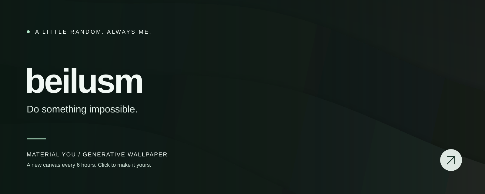

<!-- WALLPAPER:START -->

<b>Minimal Waves · Midnight Green</b> 
A new wallpaper every 6 hours · <a href="https://beilusm.github.io/material-you-wallpaper/#wallpaper=WzEsIndhdmVzIiwxNjAwLDY0MCwiIzIzMmIyNyIsIiMxMzE3MTUiLDQsMTIsMC41MjE4NzM5ODM1MDUwNjQ1LDEsdHJ1ZSx0cnVlLDAsMTM5ODQ2MTI5MV0">Edit / download this wallpaper ↗</a> 
Last generated: 2026-11-25 08:25 UTC

<!-- WALLPAPER:END -->

  Turning ideas into reality, and experiments into projects.

Built with curiosity. Painted by code.

