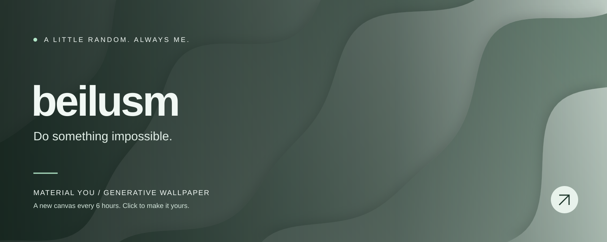

<!-- WALLPAPER:START -->

<b>Minimal Waves · Pine Forest</b> 
A new wallpaper every 6 hours · <a href="https://beilusm.github.io/material-you-wallpaper/#wallpaper=WzEsIndhdmVzIiwxNjAwLDY0MCwiIzUzNzA2MCIsIiNlMmVjZTYiLDYsLTQyLDAuNDE1MjM5MTc3NjU4NDQ1MzcsMix0cnVlLHRydWUsMCwxMTQzMDI0MjAwXQ">Edit / download this wallpaper ↗</a> 
Last generated: 2026-11-07 21:46 UTC

<!-- WALLPAPER:END -->

  Turning ideas into reality, and experiments into projects.

Built with curiosity. Painted by code.

