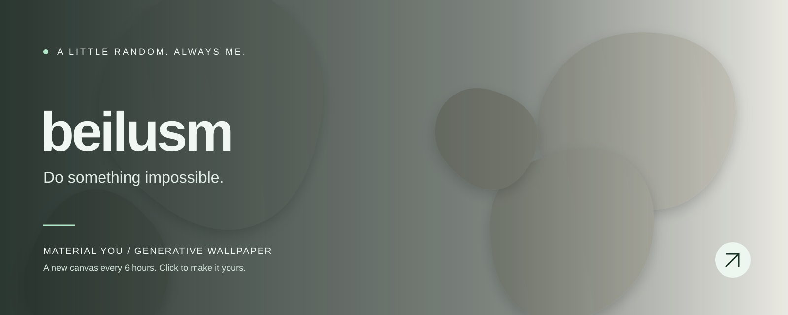

<!-- WALLPAPER:START -->

<b>有机圆石 · 灰雾金沙</b> 
每 6 小时换一张 · <a href="https://beilusm.github.io/material-you-wallpaper/#wallpaper=WzEsInBlYmJsZXMiLDE2MDAsNjQwLCIjZDJjY2JlIiwiI2Y3ZjVlZiIsNCwtMTEsMC4zMDExNTU4MjcxMjU2Nzk1LDIsdHJ1ZSx0cnVlLDAsMjAyNjExMDdd">编辑 / 下载同款壁纸 ↗</a> 
最近生成：2026-11-06 18:45 UTC

<!-- WALLPAPER:END -->

  把想法做出来，把折腾变成作品。

### 正在折腾

- **[Material You 壁纸工坊](https://beilusm.github.io/material-you-wallpaper/)** — 六种生成艺术风格，自定义配色，导出 PNG / SVG。这张主页横幅也由它生成。
- **[readboy G550 · TWRP](https://github.com/beilusm/device_readboy_G550_TWRP)** — readboy G550 的 TWRP 设备树。

Built with curiosity. Painted by code.

