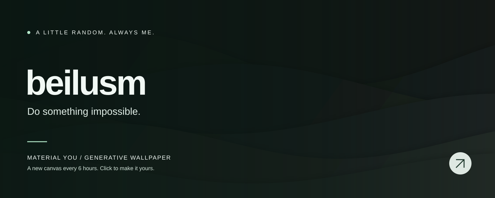

<!-- WALLPAPER:START -->

<b>Distant Hills · Midnight Green</b> 
A new wallpaper every 6 hours · <a href="https://beilusm.github.io/material-you-wallpaper/#wallpaper=WzEsImhpbGxzIiwxNjAwLDY0MCwiIzIzMmIyNyIsIiMxMzE3MTUiLDQsMzYsMC41OTgyOTc2OTc2OTk5MDU5LDEsdHJ1ZSx0cnVlLDAsMTA4MDgxMDAyXQ">Edit / download this wallpaper ↗</a> 
Last generated: 2026-11-27 08:21 UTC

<!-- WALLPAPER:END -->

  Turning ideas into reality, and experiments into projects.

Built with curiosity. Painted by code.

