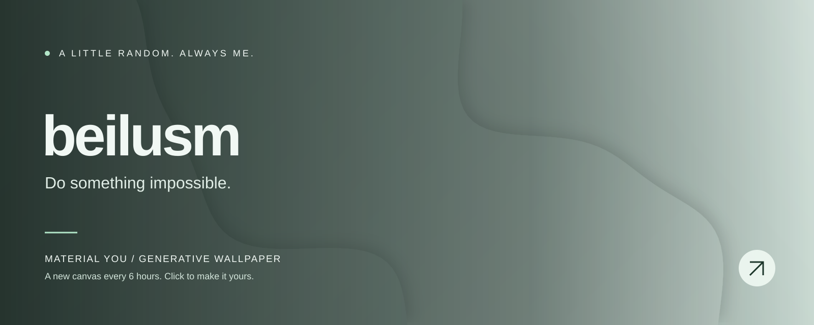

<!-- WALLPAPER:START -->

<b>Minimal Waves · Sage</b> 
A new wallpaper every 6 hours · <a href="https://beilusm.github.io/material-you-wallpaper/#wallpaper=WzEsIndhdmVzIiwxNjAwLDY0MCwiI2IyY2NjMSIsIiNlN2YyZWQiLDMsNDcsMC40MzcyNDYxODIzODYwNjEzLDIsdHJ1ZSx0cnVlLDAsMTEzNzMxMTg2NV0">Edit / download this wallpaper ↗</a> 
Last generated: 2026-11-08 05:56 UTC

<!-- WALLPAPER:END -->

  Turning ideas into reality, and experiments into projects.

Built with curiosity. Painted by code.

