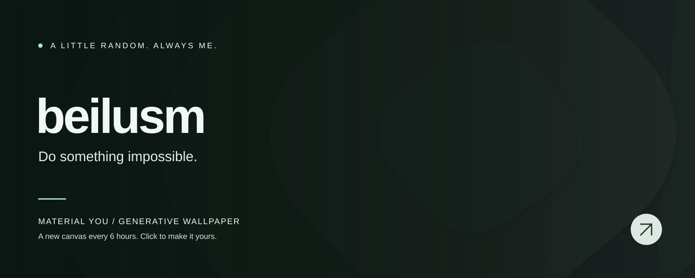

<!-- WALLPAPER:START -->

<b>Paper Topography · Midnight Green</b> 
A new wallpaper every 6 hours · <a href="https://beilusm.github.io/material-you-wallpaper/#wallpaper=WzEsInRvcG9ncmFwaHkiLDE2MDAsNjQwLCIjMjMyYjI3IiwiIzEzMTcxNSIsMyw0LDAuNDAzMzQ0NjQwMzAxODYxNDYsMix0cnVlLHRydWUsMCwxMDA0MTAyNTld">Edit / download this wallpaper ↗</a> 
Last generated: 2026-11-23 07:29 UTC

<!-- WALLPAPER:END -->

  Turning ideas into reality, and experiments into projects.

Built with curiosity. Painted by code.

