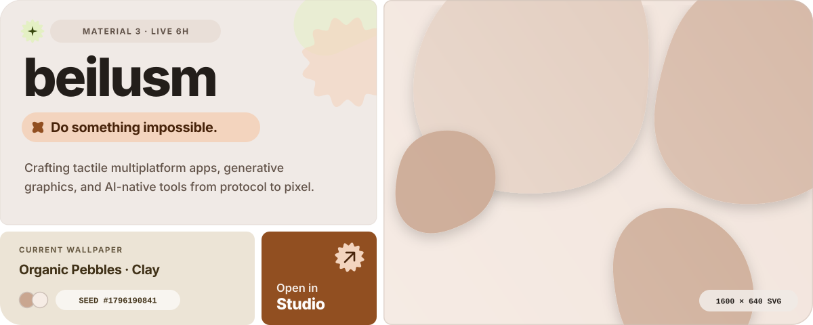
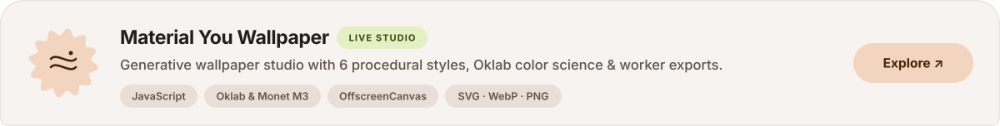
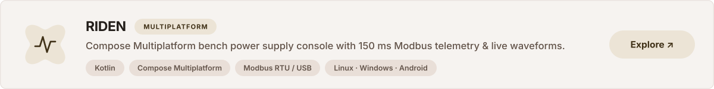
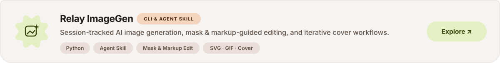
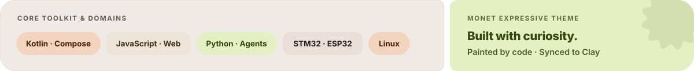

<!-- WALLPAPER:START -->

  <a href="https://beilusm.github.io/material-you-wallpaper/#wallpaper=WzEsInBlYmJsZXMiLDE2MDAsNjQwLCIjYzlhNjkwIiwiI2Y2ZWNlNSIsMywtMzUsMC4zNzg2MTM4MTM0NTc2NTA5LDEsdHJ1ZSx0cnVlLDAsMTc5NjE5MDg0MV0"><picture><source media="(prefers-color-scheme: dark)" srcset="assets/wallpaper/banner-6a287aabc802b636.svg"><source media="(prefers-color-scheme: light)" srcset="assets/wallpaper/banner-light-6a287aabc802b636.svg"></picture></a>

<!-- WALLPAPER:END -->

<!-- MONET:START -->

  <a href="https://github.com/beilusm/material-you-wallpaper"><picture><source media="(prefers-color-scheme: dark)" srcset="assets/wallpaper/work-wallpaper-dark-6a287aabc802b636.svg"><source media="(prefers-color-scheme: light)" srcset="assets/wallpaper/work-wallpaper-light-6a287aabc802b636.svg"></picture></a> 
  <a href="https://github.com/beilusm/RIDEN"><picture><source media="(prefers-color-scheme: dark)" srcset="assets/wallpaper/work-riden-dark-6a287aabc802b636.svg"><source media="(prefers-color-scheme: light)" srcset="assets/wallpaper/work-riden-light-6a287aabc802b636.svg"></picture></a> 
  <a href="https://github.com/beilusm/relay-imagegen"><picture><source media="(prefers-color-scheme: dark)" srcset="assets/wallpaper/work-imagegen-dark-6a287aabc802b636.svg"><source media="(prefers-color-scheme: light)" srcset="assets/wallpaper/work-imagegen-light-6a287aabc802b636.svg"></picture></a>

  <picture><source media="(prefers-color-scheme: dark)" srcset="assets/wallpaper/toolkit-dark-6a287aabc802b636.svg"><source media="(prefers-color-scheme: light)" srcset="assets/wallpaper/toolkit-light-6a287aabc802b636.svg"></picture>

  Auto-regenerated every 6 hours (2026-11-28 11:14 UTC) · <a href="https://beilusm.github.io/material-you-wallpaper/#wallpaper=WzEsInBlYmJsZXMiLDE2MDAsNjQwLCIjYzlhNjkwIiwiI2Y2ZWNlNSIsMywtMzUsMC4zNzg2MTM4MTM0NTc2NTA5LDEsdHJ1ZSx0cnVlLDAsMTc5NjE5MDg0MV0">Download raw 1600×640 SVG or remix seed ↗</a>

<!-- MONET:END -->
