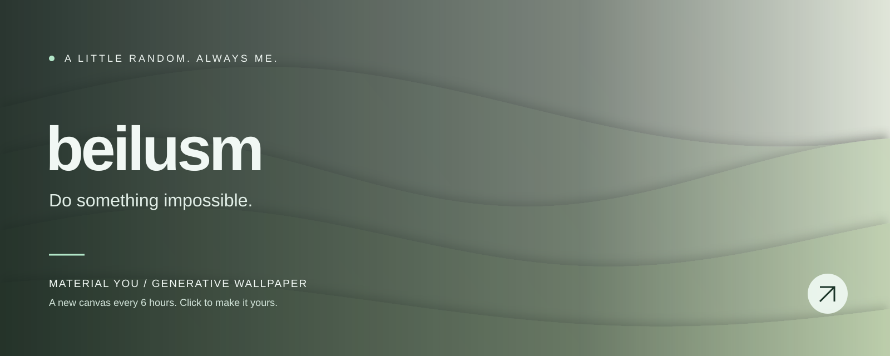

<!-- WALLPAPER:START -->

<b>Distant Hills · Matcha</b> 
A new wallpaper every 6 hours · <a href="https://beilusm.github.io/material-you-wallpaper/#wallpaper=WzEsImhpbGxzIiwxNjAwLDY0MCwiI2M0ZDdiMiIsIiNmMWY1ZWIiLDMsLTM5LDAuNDc4MDcxNjY2MjU1NjYsMSx0cnVlLHRydWUsMCwxNzA5Nzk5MDFd">Edit / download this wallpaper ↗</a> 
Last generated: 2026-11-24 22:22 UTC

<!-- WALLPAPER:END -->

  Turning ideas into reality, and experiments into projects.

Built with curiosity. Painted by code.

