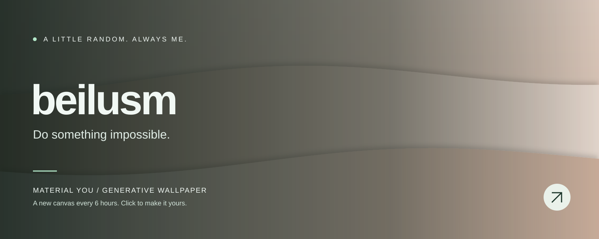

<!-- WALLPAPER:START -->

<b>Minimal Waves · Clay</b> 
A new wallpaper every 6 hours · <a href="https://beilusm.github.io/material-you-wallpaper/#wallpaper=WzEsIndhdmVzIiwxNjAwLDY0MCwiI2M5YTY5MCIsIiNmNmVjZTUiLDMsLTEsMC4zNzI5MTcyNTgyNDg1ODczNSwxLHRydWUsdHJ1ZSwwLDk1NDgwNDk1N10">Edit / download this wallpaper ↗</a> 
Last generated: 2026-11-10 07:12 UTC

<!-- WALLPAPER:END -->

  Turning ideas into reality, and experiments into projects.

Built with curiosity. Painted by code.

