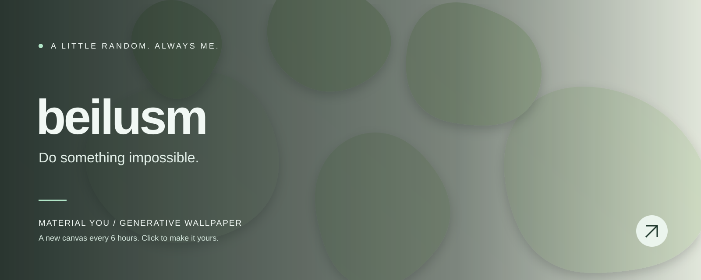

<!-- WALLPAPER:START -->

<b>Organic Pebbles · Matcha</b> 
A new wallpaper every 6 hours · <a href="https://beilusm.github.io/material-you-wallpaper/#wallpaper=WzEsInBlYmJsZXMiLDE2MDAsNjQwLCIjYzRkN2IyIiwiI2YxZjVlYiIsNSwtNTEsMC40NDY5MzAwMTc2Njg2ODg3LDIsdHJ1ZSx0cnVlLDAsMTQyMzc1Ml0">Edit / download this wallpaper ↗</a> 
Last generated: 2026-11-19 07:19 UTC

<!-- WALLPAPER:END -->

  Turning ideas into reality, and experiments into projects.

Built with curiosity. Painted by code.

