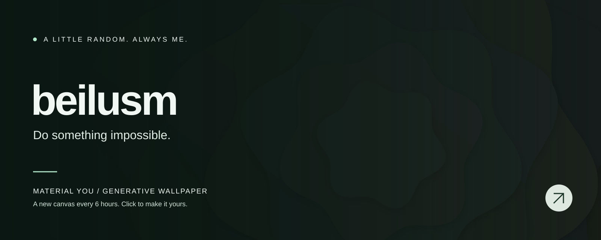

<!-- WALLPAPER:START -->

<b>Layered Bloom · Midnight Green</b> 
A new wallpaper every 6 hours · <a href="https://beilusm.github.io/material-you-wallpaper/#wallpaper=WzEsImJsb29tIiwxNjAwLDY0MCwiIzIzMmIyNyIsIiMxMzE3MTUiLDYsLTU0LDAuNTk1Mjk2NTIxNDEwNjIyMiwxLHRydWUsdHJ1ZSwwLDIwNjY0NTQ0Mjhd">Edit / download this wallpaper ↗</a> 
Last generated: 2026-11-28 07:41 UTC

<!-- WALLPAPER:END -->

  Turning ideas into reality, and experiments into projects.

Built with curiosity. Painted by code.

