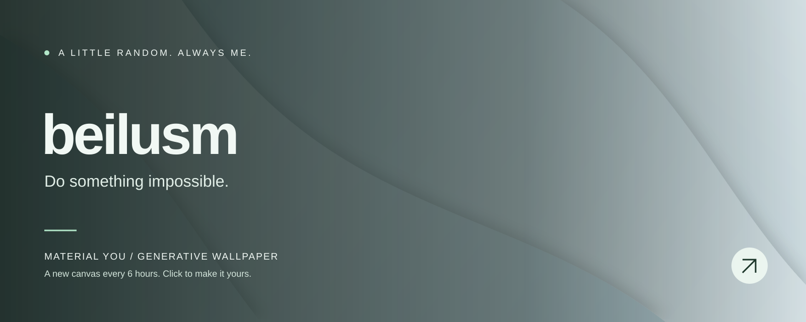

<!-- WALLPAPER:START -->

<b>Minimal Waves · Glacier Blue</b> 
A new wallpaper every 6 hours · <a href="https://beilusm.github.io/material-you-wallpaper/#wallpaper=WzEsIndhdmVzIiwxNjAwLDY0MCwiI2IwY2JkNiIsIiNlYmYzZjYiLDQsMzksMC40NTI1MDQ0OTMwODg5MzEyNiwxLHRydWUsdHJ1ZSwwLDEzMjg0OTg3MDRd">Edit / download this wallpaper ↗</a> 
Last generated: 2026-11-26 21:27 UTC

<!-- WALLPAPER:END -->

  Turning ideas into reality, and experiments into projects.

Built with curiosity. Painted by code.

