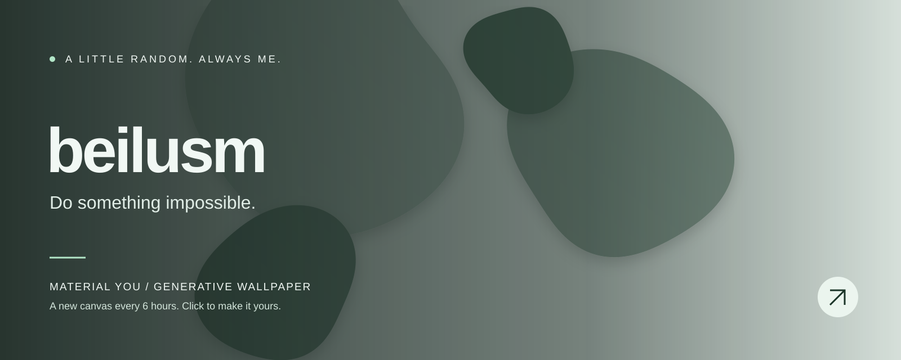

<!-- WALLPAPER:START -->

<b>Organic Pebbles · Pine Forest</b> 
A new wallpaper every 6 hours · <a href="https://beilusm.github.io/material-you-wallpaper/#wallpaper=WzEsInBlYmJsZXMiLDE2MDAsNjQwLCIjNTM3MDYwIiwiI2UyZWNlNiIsMywtNTMsMC42MzQ2ODQzNDYyMjk0NzUzLDIsdHJ1ZSx0cnVlLDAsNzAzNzQwMTc3XQ">Edit / download this wallpaper ↗</a> 
Last generated: 2026-11-07 12:55 UTC

<!-- WALLPAPER:END -->

  Turning ideas into reality, and experiments into projects.

Built with curiosity. Painted by code.

