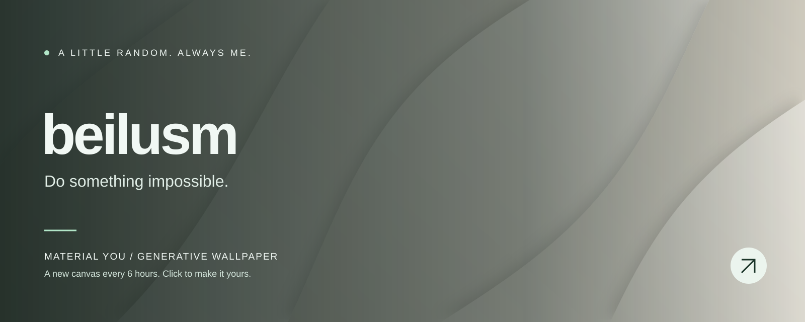

<!-- WALLPAPER:START -->

<b>Minimal Waves · Golden Mist</b> 
A new wallpaper every 6 hours · <a href="https://beilusm.github.io/material-you-wallpaper/#wallpaper=WzEsIndhdmVzIiwxNjAwLDY0MCwiI2QyY2NiZSIsIiNmN2Y1ZWYiLDYsLTQ5LDAuMzMyNjYwMDQ4MTU5NDU0MDUsMSx0cnVlLHRydWUsMCwxNTQ2MjQ4MzkwXQ">Edit / download this wallpaper ↗</a> 
Last generated: 2026-11-17 07:50 UTC

<!-- WALLPAPER:END -->

  Turning ideas into reality, and experiments into projects.

Built with curiosity. Painted by code.

